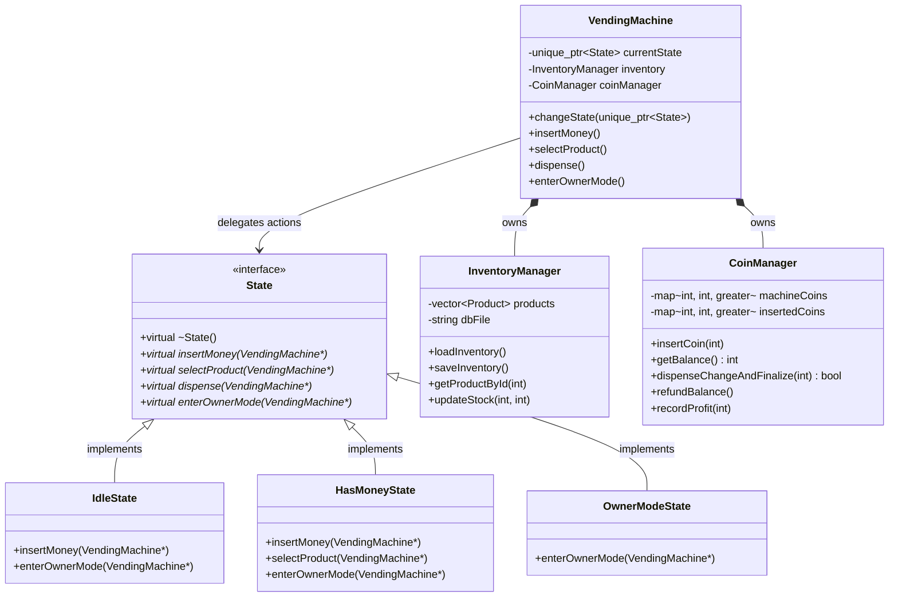
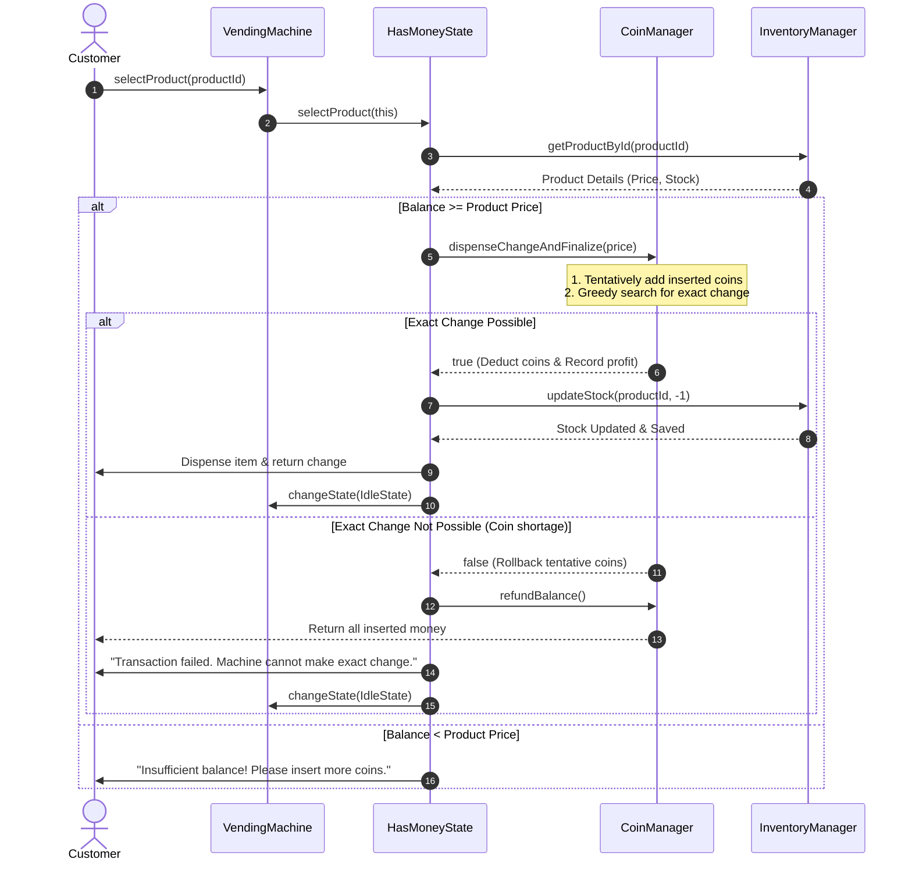

# Vending Machine Simulator (C++)

[](https://en.cppreference.com/w/cpp/17)
[](https://cmake.org/)
[-orange.svg)](https://en.wikipedia.org/wiki/State_pattern)
[](#running-tests)

A modular, production-grade Low-Level Design (LLD) simulation of a real-world vending machine implemented in modern C++. Built around the **GoF State Design Pattern**, an exact-change **Greedy Denomination Algorithm** with transactional rollback, and fault-tolerant file persistence.

---

## 📌 Project Overview & Highlights

- **State-Machine Architecture:** Implements the State Design Pattern to cleanly isolate operational modes (`Idle`, `HasMoney`, `OwnerMode`), eliminating brittle conditional cascades and enforcing strict transition rules.
- **Denomination-Based Coin Manager:** Tracks physical coins (₹1, ₹2, ₹5, ₹10, ₹20) using descending associative containers (`std::map<int, int, std::greater<int>>`). Features an exact-change greedy algorithm with rollback safety.
- **Encapsulated Subsystems:** Decoupled inventory management, profit auditing, and state tracking adhering to SOLID principles.
- **Hardened Console I/O & Recovery:** Guarded stream input layers (`Utils.h`) eliminate `std::cin` fail-bit infinite loops, and `InventoryManager` gracefully ignores corrupted data file entries.
- **Modern C++ Semantics:** Strictly adheres to RAII, leveraging `std::unique_ptr` and `std::move` for zero-leak dynamic polymorphism without raw pointers.
- **Automated Unit Testing:** Integrated CMake test suite (`tests/test_vending.cpp`) verifying the greedy change engine and inventory state.

---

## 🏗️ System Architecture & Visual Design

### 1. High-Level Component Architecture



---

### 2. State-Machine Transition Diagram

```mermaid
stateDiagram-v2
    [*] --> IdleState : Machine Boot

    state IdleState {
        description: Waiting for customer or technician
    }

    state HasMoneyState {
        description: Customer inserted coins; can select items or refund
    }

    state OwnerModeState {
        description: Authenticated maintenance mode (Password protected)
    }

    IdleState --> HasMoneyState : insertCoin (valid denomination)
    IdleState --> OwnerModeState : enterOwnerMode (Password: vending123)

    HasMoneyState --> HasMoneyState : insertCoin (increment balance)
    HasMoneyState --> IdleState : Cancel / Refund Balance
    HasMoneyState --> IdleState : Successful Purchase (Dispensed + Change given)
    HasMoneyState --> IdleState : Change Unavailable (Rollback + Full Refund)
    HasMoneyState --> IdleState : enterOwnerMode (Forced Auto-Refund first)

    OwnerModeState --> IdleState : Exit Owner Mode
```

---

### 3. Transaction Flow with Rollback Protection



---

## ⚙️ Core Subsystems & Technical Details

### 1. State Design Pattern (`State.h`, `ConcreteStates.h`, `VendingMachine.h`)
- **Intent:** Allow the vending machine to alter its behavior when its internal state changes without cluttering caller code with monolithic `if-else` or `switch` statements.
- **SOLID Compliance:** Adheres strictly to the **Single Responsibility Principle (SRP)** by keeping transition rules inside each dedicated state class, and the **Open/Closed Principle (OCP)** by allowing new states (e.g., `DispensingState`, `CardPaymentState`) to be plugged in without modifying existing code.
- **Memory Safety:** Transitions use `std::unique_ptr<State>` and `std::move()`, enforcing exclusive ownership and automatic RAII destruction of prior states.

### 2. Greedy Coin Change Algorithm (`CoinManager.h`)
- Real-world vending machines do not store balances as simple scalar numbers; they manage discrete physical coin hoppers.
- The machine maintains denominations sorted in descending order:
  $$\{20, 10, 5, 2, 1\}$$
- When dispensing change $C = \text{Balance} - \text{Price}$:
  1. Computes optimal coin counts: $\text{count} = \min(\lfloor \frac{\text{remainingChange}}{d} \rfloor, \text{hopperCount}[d])$.
  2. If $\text{remainingChange} = 0$, commits the transaction and saves profits to `profit.txt`.
  3. If $\text{remainingChange} > 0$ (inventory cannot provide exact change), **rolls back** machine hoppers to pre-transaction counts, refunds all inserted coins, and cancels dispensing.

### 3. Fault-Tolerant File Persistence (`InventoryManager.h`)
- Reads catalog and stock levels from `input.txt`.
- Robust parsing via `std::stringstream` and scoped `try-catch` blocks:
  - Validates that `ID > 0`, `Price >= 0`, and `Stock >= 0`.
  - Non-numeric or corrupted records in the file are logged as warnings and skipped, preserving application stability.

### 4. Resilient Console Stream I/O (`Utils.h`)
- Standard C++ `std::cin >> int` sets `std::ios::failbit` on invalid string input, causing console applications to enter uncontrollable infinite loops.
- `Utils::getIntInput()` encapsulates stream validation:
  ```cpp
  if (!(std::cin >> choice)) {
      std::cin.clear();
      std::cin.ignore(std::numeric_limits<std::streamsize>::max(), '\n');
  }
  ```

---

## 📂 Project Structure

```
Vending_Machine_Git/
├── CMakeLists.txt         # Build configuration & CTest targets
├── CoinManager.h          # Denomination tracker, greedy change algorithm & profit logger
├── ConcreteStates.h       # Implementations of IdleState, HasMoneyState, OwnerModeState
├── InventoryManager.h     # Flat-file database parsing, stock updates & error recovery
├── Product.h              # Encapsulated product entity model
├── State.h                # Abstract State interface (GoF State Pattern)
├── Utils.h                # Robust stream input sanitization
├── main.cpp               # Simulation entry point & interactive UI loop
├── input.txt              # Persistent product inventory file
├── profit.txt             # Persistent revenue audit file
├── tests/
│   └── test_vending.cpp   # Automated unit tests for CoinManager and Product
└── README.md              # Project documentation
```

---

## 🚀 Build & Execution Guide

### Prerequisites
- Modern C++ Compiler supporting **C++17** (GCC 9+, Clang 10+, or MSVC 2019+)
- **CMake 3.14+**

### 1. Building the Project
```bash
# Clone the repository
git clone https://github.com/<your-username>/Vending_Machine_Git.git
cd Vending_Machine_Git

# Generate build files and compile
mkdir build
cd build
cmake ..
cmake --build .
```

### 2. Running the Simulator
```bash
# On Linux / macOS:
./vending

# On Windows:
.\Debug\vending.exe
```

### 3. Running Automated Tests
The repository includes a dedicated test suite verifying edge cases in change computation and inventory management:
```bash
# Within the build/ directory:
ctest --output-on-failure

# Or run the test executable directly:
./test_vending
# Windows: .\Debug\test_vending.exe
```

---
